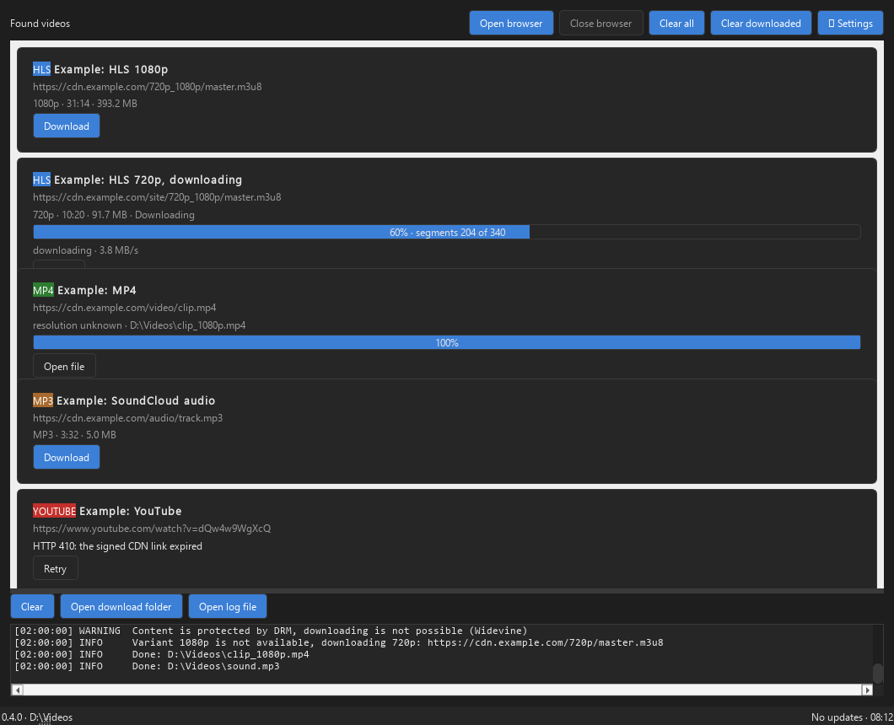
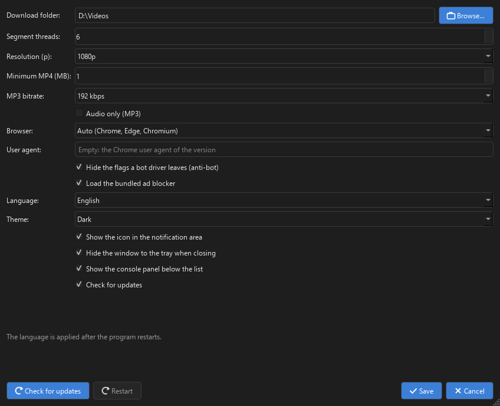

# PyDownloader

A Windows application for downloading video from the browser: the user opens a
controlled browser with the "Open browser" button, the program intercepts the
network requests of that browser, finds HLS (`.m3u8`), MPEG-DASH (`.mpd`),
direct MP4, YouTube streams and audio sources, and joins the downloaded segments
with FFmpeg into one `.mp4` (a source of sound only is written as `.mp3`). The
interface is dark by default; light and system themes are available in the
settings, the program lives in the Windows tray, and the browser window can be
opened and closed by the user.

## Screenshots





The screenshots are rendered by the `tools/make_screenshots.py` script (`uv run python
tools/make_screenshots.py`): it fills the cards and the console with demo data, and
the script has no browser and no downloads, so the screenshots are reproducible. The
windows are never shown on the desktop — the snapshot is taken with `QWidget.grab()`
on the offscreen Qt platform.

## How it works

1. Launch → pick the downloads folder (first run only). The main window opens with
   two sections: found videos (top) and console (bottom). **The browser is not
   started automatically** — press "Open browser" when you want to look for a video.
2. The browser window opens maximised on the last page you visited, with the uBlock
   ad blocker enabled (see below). It carries no banners of a driver: neither
   "this build is for automated testing" nor the "unsupported command-line flag"
   strip under the address bar.
3. The user visits the site and starts the video himself — the application intercepts
   manifests and shows what it found as cards. If the site signs every URL separately
   (e.g. phncdn), the download uses the exact signed URLs from the browser traffic.
   If the playlist is requested inside the page and only segments are visible, three
   GET requests from one directory form an HLS card.
4. Downloading starts **only after pressing "Download"**; downloads run strictly
   sequentially, segments use up to 6 threads.
5. Segments (decrypted with AES-128 when required) are joined by FFmpeg
   (`-c copy`) into the finished `.mp4`, and the task's temporary folder is deleted.
   A source that is audio only (SoundCloud, a radio stream, an audio-only HLS
   playlist) is decoded with `libmp3lame` and written as `.mp3` at the bitrate
   chosen in the settings; audio is never muxed into a black video file.
6. YouTube: the page itself requests the inner-tube player API (VISIONOS client),
   so the classic signed URLs are available. Video and audio are downloaded in 8 MB
   range blocks and muxed without re-encoding.

Live streams, DRM-protected content (Widevine / PlayReady / FairPlay) and streams
without a variant of one of the presets **1080p, 720p, 480p** are skipped; the
reason is written to the console. An exact match is taken (a 1440p source is
downloaded as 1080p), an HLS playlist of sound only is accepted without a
preset. DRM bypass (including Widevine) is not supported.

## Card states

`Found` → `Queued` → `Downloading` (progress, speed, segments X of Y, stage,
"Cancel") → `Done` ("Open file" — plays the downloaded file in the default player)
/ `Error` ("Retry").

Each card shows the source type badge: HLS, DASH, MP4, YOUTUBE, and **MP3** for
an audio source, plus the quality line: `1080p`, `720p`, `480p`, the resolution
when it is known, or `MP3`. A card with a source is never cut off: the list of
cards has its own scrollbar, and when the window is made small the card section
keeps its minimum height and the console shrinks.

Above the list of found videos there are four buttons:
- **"Clear all"** — remove every card.
- **"Clear downloaded"** — remove only the cards whose files are on disk.
- **"Open browser"** — show the browser window, on the page where the user was last.
- **"Close browser"** — close the browser window. Downloads keep running.

## Tray

The program lives in the Windows notification area. Pressing **X** in the window
title bar hides the window to the tray, the downloads keep running, and the
browser stays open; closing the program from the tray menu is the only way to
quit. The tray menu offers: show the window, open and close the browser, check
for updates, open the downloads folder, exit. A single click or a double click
on the tray icon shows the window; the menu items of the browser follow the
state of the browser window. The first time the window is hidden, the tray icon
shows a balloon explaining the menu (the hint is shown once).

The tray settings are "Show the icon in the notification area" and "Hide the
window to the tray when closing" (both on by default). If the system has no
notification area (Windows Server, a remote desktop session, the offscreen CI of
the tests), the tray icon is not created and "X" works as before: it closes the
program.

## Browser controls

"Open browser" shows the browser window on the last page the user visited,
maximised; "Close browser" closes it. The program does not open the browser by
itself: the first window of the run is the window of the program, and the
browser appears only after the user presses the button, so nothing is launched
in the background. Closing the browser window does not stop
an active download: the segments are downloaded by the program itself, not by
the browser, so the task finishes after the window is closed. When the browser
is closed, its thread is replaced by a new one (the Playwright objects of a
closed browser belong to the event loop of the old thread), and the user's
profile is read from disk again, so cookies, logins and site settings are the
same as before the closing. If the browser is not open, "Open browser" starts
it with the program's profile on the last page; when it is already open, the
button does nothing and "Close browser" is enabled.

## Logging

The program writes a diagnostic log to `<install folder>\logs\app.log` (if the
install folder is not writable — to `%LOCALAPPDATA%\PyDownloader\logs\app.log`;
rotation: 5 MB × 3 files). Everything goes into the file: every intercepted
browser response, manifest and segment requests with response codes, cookies,
quality decisions, the selected variant, the task plan, the FFmpeg command and
errors. The window console shows only the important lines (INFO and above), so
the window does not slow down on long segment lists.

If a stream is not found or a download fails — press "Open log file" in the window
(the log path is also printed to the console at startup) and send the file: the
log shows which URLs the player requested and what the server answered.

## Settings

Settings are stored in `%APPDATA%\PyDownloader\settings.json`: downloads folder,
number of threads, theme, quality preset, MP3 bitrate, audio-only mode,
minimum MP4 size, browser, anti-bot, ad blocker, language, tray options, update
check, window size and position. The downloads folder is asked only on the first
run; on later runs the program takes it from the settings and creates it if it
was deleted. The folder can be changed in "Settings" → "Downloads folder" — the
value is saved right after pressing "Save". The settings dialog takes 80% of the
main window's width and height, can be resized manually, and a long path is
fully visible (and in the tooltip on hover).

"Resolution (p)" is a combo with three presets: **1080p, 720p, 480p** (an
out-of-list height saved in an edited `settings.json` gets its own entry). "MP3
bitrate" is 128 / 192 / 320 kbps, "Audio only (MP3)" downloads only the sound
part, "User agent" imitates another device (an empty field takes the Chrome
string of the version launched), "Hide the flags a bot driver leaves (anti-bot)"
switches stealth on and off, "Load the bundled ad blocker" is on by default,
and the tray rows are described above.

## Languages

The interface and the log lines are in English, Russian, Ukrainian, Chinese,
French and German; English is the default. The language is chosen in
Settings → Language; the native names shown in the combo are English, Русский,
Українська, 中文, Français, Deutsch. The choice is stored in
`%APPDATA%\PyDownloader\settings.json` as `"language"` and is applied after the
program restarts — the Settings dialog shows a hint and a Restart button.

## Anti-bot

Google and SoundCloud check the browser the page runs in and report "JavaScript
disabled / cookies blocked" when an automation tool opens it. The program makes
the browser look like an ordinary user's browser:
- the automation flags are removed: the "AutomationControlled" feature is
  disabled, so `navigator.webdriver` is undefined, a stealth script fixes the
  properties that bots usually leak (plugins, languages, `hardwareConcurrency`,
  `deviceMemory`, `window.chrome`, the notification permission, the brands of
  `navigator.userAgentData`), the sandbox switch is dropped;
- the user agent is taken from the real installed browser, not from
  Playwright's default one, with matching platform and locale hints
  (`en-US` / `ru-RU` / `uk-UA` from the language chosen in the settings);
- the browser runs with a **persistent profile** in the program's folder, so
  cookies, local storage, logins, extensions and site settings are kept between
  runs — after signing in to Google once the program is not asked to sign in
  again, and the same profile is sent to Google on every start;
- autoplay is allowed, the browser starts maximised, and the window looks like
  a normal browser window, not the stripped Playwright window;
- the banners a driver provokes are hidden: the Chrome for Testing that
  Playwright ships writes "this build is for automated testing" with a proposal
  to install a regular Chrome, and Chrome, Edge and that same build write "you
  are using an unsupported command-line flag" under the address bar. The launch
  keeps `--disable-infobars` in the defaults (the build of Testing answers to
  it) and adds `--test-type` (the switch the installed Chrome and Edge answer
  to), so none of these strips is shown.

"Anti-bot" is a setting (on by default); turning it off returns the plain
Playwright launch, which is useful to compare. The log records the launch
arguments, the user agent, the locale, the stealth script result and the profile
path, so a login problem can be diagnosed from `app.log`.

A site that checks the DevTools protocol (a CDP leak) can still tell that the
browser is driven by a program: a full anti-detection suite (a patched browser,
CDP isolation, fingerprint tools) is out of scope. The program is made for
sites that play video for a user who logs in himself, not for evading a
detection service.

## Ad blocker and browser choice

Next to the program lies `uBlock.crx` (uBlock Origin Lite). At startup it is
unpacked into `<install folder>\extensions` and attached to Chromium from
Playwright. Chrome 157 and Edge 157 ignore extensions passed from the command
line, so for the blocker the program offers to download Chromium once (it lands
in `<install folder>\browsers`); without it the browser opens with no blocker.
Chromium downloaded by a previous version into
`%LOCALAPPDATA%\PyDownloader\browsers` is found and reused — it is not
downloaded again.

Settings → "Browser" chooses the engine: **Automatic** (installed Chrome, then
Edge, then Chromium), **Google Chrome**, **Microsoft Edge**, **Chromium**. The
chosen engine is remembered; when it is not installed, the program falls back to
an installed one and Chromium, and asks to download Chromium when Chromium is
wanted.

The browser profile lives in the program folder — `<install folder>\profile` —
and contains cookies, account logins and site settings. It persists between
program runs and updates. The profile of a previous version from
`%LOCALAPPDATA%\PyDownloader\profile` is moved there automatically on the first
run. If the program folder is not writable (e.g. `Program Files` without
administrator rights), the profile, logs, Chromium and the unpacked blocker stay
in `%LOCALAPPDATA%\PyDownloader`. In "Settings" you can instead keep the profile
in `<downloads folder>\.profile`.

## Where the data lives

| What | Where |
| --- | --- |
| Program, `bin\ffmpeg.exe`, `uBlock.crx` | install folder |
| Browser profile (cookies, sessions) | `<install folder>\profile` |
| Chromium from Playwright | `<install folder>\browsers` |
| Unpacked ad blocker | `<install folder>\extensions` |
| Log file | `<install folder>\logs` |
| Settings | `%APPDATA%\PyDownloader\settings.json` |

Everything except the settings lives in the install folder: deleting it deletes
the profile, the downloaded browser, the blocker and the logs too. The settings
stay in `%APPDATA%` to survive a reinstall. If the install folder is not
writable, these folders are created in `%LOCALAPPDATA%\PyDownloader`.

## Requirements

- Windows 10/11 x64; Chrome or Edge, or Chromium from Playwright (the
  application offers to download it on first run). The ad blocker requires
  Chromium specifically. The browser to launch is chosen in the settings.
- The tray icon needs the Windows notification area. On a system without it
  (Windows Server, a remote desktop session) the program works with the tray
  switched off.
- Python 3.12 only for building; the installed application runs without Python.

## Running from source

Double-click `run.bat` in the repository root (or run `run.bat` from the
console). The script sets `PYTHONPATH=src` and runs `python -m pydownloader`
from `.venv`, so the current code always works — no rebuild is needed. If
`.venv` is absent, `uv run` is used. The console window stays open on an
error, so the traceback is visible.

## Build

```powershell
uv sync --extra dev
winget install -e --id JRSoftware.InnoSetup   # needed for the installer
.\build.ps1                                    # version, PyInstaller, ISCC, SHA-256
```

Result: `dist/PyDownloader/PyDownloader.exe` (the program folder, FFmpeg inside
`bin`), `dist/install/PyDownloader-Setup-<version>.exe` and the `.sha256` file.
`uBlock.crx` lies in the repository, is copied into `dist/PyDownloader` and
lands in the installer — the GitHub Actions build also contains the blocker.
The version is taken from `git describe --tags` (`0.0.0-dev` in development).

## Installation

`PyDownloader-Setup-<version>.exe` installs the program to
`Program Files\PyDownloader`, creates shortcuts and offers to run it. Silent
install:
`PyDownloader-Setup-<version>.exe /SILENT /SUPPRESSMSGBOXES /CLOSEAPPLICATIONS`.
Uninstallation deletes the install folder with all its data (browser profile,
downloaded Chromium, unpacked blocker, logs). The settings
(`%APPDATA%`) and the data in `%LOCALAPPDATA%` are deleted only after
confirmation in the dialog.

## Updates

The application checks `GitHub Releases` of the `flynet/pyDownloader` repository,
shows the release notes, downloads the installer, verifies SHA-256 and runs it
with `/SILENT /CLOSEAPPLICATIONS`. The automatic check is disabled in the
settings.

## Structure

```
src/pydownloader/
  i18n.py   language of the interface and of the log lines, ``tr`` lookup
  locales/  catalog of texts: English, Russian, Ukrainian, Chinese, French, German
  hls/      .m3u8 parser and model
  dash/     .mpd parser and model
  manifest/ candidate detection (audio/video), DRM, quality presets
            (1080p / 720p / 480p), source registry, probe pipeline
  util/     URLs, file names, ranges, logging
  config/   settings, paths, repository constants
  browser/  browser launch, stealth flags and user agent, ad blocker,
            network interception, Chromium download
  download/ queue, segments, AES-128, direct MP4, MP3 output
  youtube/  inner-tube player API, format parsing, range plan
  ffmpeg/   locating ffmpeg.exe, ffprobe media info, the join, MP3 encode
  update/   release checks and installer launch
  ui/       window, cards, console, settings, themes, tray
tests/      pytest + sample playlists, MPDs, ffprobe output
```

## Tests

```powershell
ruff check src tests
mypy src
pytest
```

## Licenses

Third-party components and their licenses are listed in the `NOTICE` file. The
technical specification is in `docs/TZ_HLS_Grabber_Python.md`.
